<h1 align="center">Ahmad Aqib</h1>

  <b>Full-stack developer</b> &nbsp;·&nbsp; Laravel, Vue, TypeScript, Go &nbsp;·&nbsp; Makassar, Indonesia

  <i>I build web apps, and I stick around for what happens after they go live.</i>

  <a href="https://ahmadaqib.site"><strong>Portfolio ↗</strong></a> &nbsp;·&nbsp;
  <a href="mailto:ahmadaqibsunu@gmail.com">Email</a> &nbsp;·&nbsp;
  <a href="https://www.instagram.com/ahmadaqibb/">Instagram</a>

---

Hey, I'm Aqib. I spend most of my days somewhere between application code, databases, and servers.

I'm drawn to the work people quietly avoid: the endpoint that's been slow for months, the deploy that needs a checklist and a little prayer, the module nobody touches since the last change broke something. I like finding out why, and leaving it in better shape than I found it.

I also care about the part before the code. Talking through scope, asking the slightly annoying *"what happens if…"* questions early, and making sure whatever we decide is something the team can actually keep doing.

## Things I've built

| Project | What it does | Built with |
| :-- | :-- | :-- |
| **[ngafe.space ↗](https://github.com/ahmadaqib/ngafe.space)** | Café discovery and reviews for students in Makassar. Comes with moderation tools, because reviews need a bit of looking after. | Laravel, Livewire |
| **[Sniper-Loker ↗](https://github.com/ahmadaqib/Sniper-Loker)** | Pulls job listings from several sources and pushes new ones to you the moment they appear. | Go, WebSockets |

## What I work with

  

| Area | Day to day |
| :-- | :-- |
| **Backend** | PHP, Laravel, Go, Rust |
| **Frontend** | Vue, React, TypeScript, Livewire, Tailwind |
| **Data** | PostgreSQL, MySQL, Redis |
| **Running it** | Docker, Linux, Nginx, Cloudflare, CI/CD |

<strong>And a few more</strong>

 
Python, Node.js, and CodeIgniter on the backend. MongoDB and Firebase for data. Flutter and native Android for mobile. Outside of code, some design and 3D work in Figma, Photoshop, Blender, and Cinema 4D.

  

## What I'm learning right now

- **Running ML models inside a backend.** Training and fine-tuning, exporting to ONNX, and loading it from Go, so a model lives in a regular service and not just a notebook.
- **Going deeper with Go and Rust.** Shipping a small tool that solves a real problem, with the trade-offs written down and benchmarks that actually mean something.
- **Performance work with receipts.** Making a slow path reproducible, then showing an honest before and after.
- **Boring deploys.** Repeatable releases, and practicing the rollback before I need it.
- **Distributed systems.** What happens when work gets retried, delayed, or cut off halfway.

<strong>How I use AI</strong>

 
I use Codex, Claude Code, and ChatGPT pretty much every day, and Gemini now and then. Mostly to find my way around unfamiliar code, compare approaches, draft tests, and get a second pair of eyes on a change.

But I still read the diff, check it against the business rules, and make sure I know what a change actually does before it ships. The tools help. The responsibility stays with me.

## A problem I keep coming back to

A customer places an order. The server saves it, but the response never makes it back. The client retries, and now there are two orders from someone who only wanted one.

A longer timeout or a disabled submit button helps a little, but neither fixes it. What I'd reach for is an **idempotency key**: the client sends the same key on every retry, and the server enforces it as unique, even when two requests land at the same moment.

The edges are where it gets interesting:

- What if the order gets saved but the key doesn't?
- Do the payment, the stock update, and the notification each survive a retry?
- Same key, different payload? I'd reject it. One identity shouldn't quietly start meaning something else.

[Stripe's take on this](https://docs.stripe.com/api/idempotent_requests) is worth a read. And if you've run into your own version of this problem, I'd honestly love to hear it.

## Let's talk

> [!TIP]
> **Open to** engineering projects, architecture discussions, and collaborations.

No polished brief needed. Tell me what you're building, where it's stuck, and what you're working around. That's plenty to start with.

**[Send me an email →](mailto:ahmadaqibsunu@gmail.com)** &nbsp;·&nbsp; **[See my portfolio ↗](https://ahmadaqib.site)**

---

  <picture>
    <source media="(prefers-color-scheme: dark)" srcset="https://raw.githubusercontent.com/ahmadaqib/ahmadaqib/output/profile-3d-contrib/profile-night-rainbow.svg">
    <source media="(prefers-color-scheme: light)" srcset="https://raw.githubusercontent.com/ahmadaqib/ahmadaqib/output/profile-3d-contrib/profile-season-animate.svg">
    
  </picture>

  <picture>
    <source media="(prefers-color-scheme: dark)" srcset="https://raw.githubusercontent.com/ahmadaqib/ahmadaqib/output/pacman-contribution-graph-dark.svg">
    <source media="(prefers-color-scheme: light)" srcset="https://raw.githubusercontent.com/ahmadaqib/ahmadaqib/output/pacman-contribution-graph.svg">
    
  </picture>

Usually on Linux. Usually with coffee. Probably staring at a query plan.

